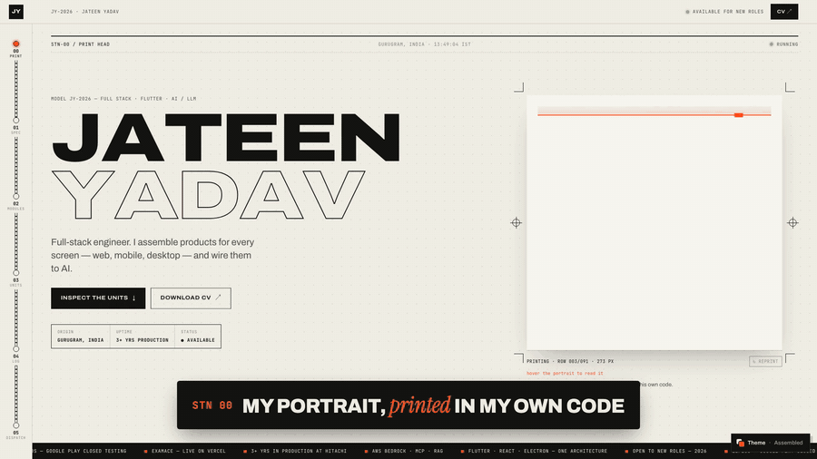

# Jateen Yadav — portfolio

Portfolio of **Jateen Yadav** — Full Stack · Flutter · AI/LLM engineer.
Live: [jateenyadav.netlify.app](https://jateenyadav.netlify.app)

[](docs/demo.mp4)

▶ [Watch the full 21-second demo with sound](docs/demo.mp4)

One site, **switchable themes** (the floating *Theme* button). Both read links, résumé and featured projects from one content file, so they stay in sync.

| Theme | Idea |
|---|---|
| **Assembled** (default) | An assembly line × print shop — my portrait printed from my own source code. |
| **Chess** | My original chessboard portfolio, restored exactly — same markup and the untouched original stylesheets (`src/themes/chess/styles/`), including its own dark / light switch. Only the content is refreshed. |

Share a theme directly with `?theme=chess`.

## Assembled

The site is an **assembly line** (a nod to the real-time factory dashboards I build at Hitachi) crossed with a **print shop**. Every section is a station on the line; a unit travels down the conveyor rail as you scroll.

| Station | What happens |
|---|---|
| **00 · Print head** | My photo is sampled into a grid and printed row by row as halftone ink dots (Canvas 2D). Every dot is also one character of my real source code from GitHub — the loupe under your cursor magnifies the dots into that code and names the file + line it's reading. |
| **01 · Spec sheet** | A machine spec plate, a statement that inks in word by word, stepped counters. |
| **02 · Modules** | Control-panel rows — hover a module to run it and its log types out. |
| **03 · Units shipped** | Each project gets a QA shipping label with a generated barcode and a stamp; screenshots print in line by line. |
| **04 · Service log** | Experience on continuous-feed green-bar printer paper, tractor holes and all. |
| **05 · Dispatch** | A thermal receipt prints out of a slot: 1 × full-stack engineer, ship to your team. |

## How the portrait works

1. `public/portrait.jpg` is drawn onto an off-screen canvas at grid resolution (84×84 desktop, 66×66 mobile).
2. Luminance → ink coverage with a contrast stretch and an unsharp mask, so eyes, brows and beard carry the likeness.
3. Each cell becomes a dot whose radius ∝ √coverage; rows are printed progressively behind an animated print head.
4. `src/data/code.ts` holds ~17.5k characters pulled from my public repos (`Me-Assistant`, `Exam-AI`). Cell *i* maps to character *i*, so the loupe shows real, readable code and resolves the exact file + line.

## How themes work

```
src/data/content.ts      ← all facts (projects, roles, stacks). Edit once, every theme updates.
src/theme/registry.ts    ← list of themes (name, colours, lazy loader)
src/theme/ThemeRoot.tsx  ← loads only the active theme, circular view-transition on switch
src/themes/<id>/         ← a theme: its own components + one stylesheet
```

- **Code-split:** visitors download only the theme they're looking at (chess ≈ 27 kB gzip, assembled ≈ 24 kB, plus shared React).
- **No style clashes:** each theme's CSS is imported with `?inline` and mounted only while that theme is on screen (`useThemeStyles`).
- **No flash:** a tiny inline script in `index.html` paints the saved theme's background before any JS loads.
- The site-level choice lives on `<html data-skin>`; the chess skin keeps its original `data-theme="dark|light"` switch.
- The choice is remembered per device (`localStorage`), and `?theme=` links override it.

**Add a theme:** create `src/themes/<id>/index.tsx` (default-export the page, call `useThemeStyles(css, '<id>')`), add an entry to `THEMES` in `registry.ts`, and add its background colour to the boot script in `index.html`.

## Stack

React 19 · TypeScript · Vite · Canvas 2D · GSAP (ScrollTrigger, SplitText) · Lenis · View Transitions API.

## Run it

```bash
npm install
npm run dev       # local dev server
npm run build     # type-check + production build → dist/
npm run shots     # refresh project screenshots (Playwright)
```

## Edit content

Shared facts (email, links, résumé, projects) live in [`src/data/content.ts`](src/data/content.ts). The chess theme's longer copy (experience write-ups, skills, certificates) lives in `src/themes/chess/ChessboardHero.tsx`, as in the original site. Swap `public/portrait.jpg` for a new photo (square, plain light background works best).
